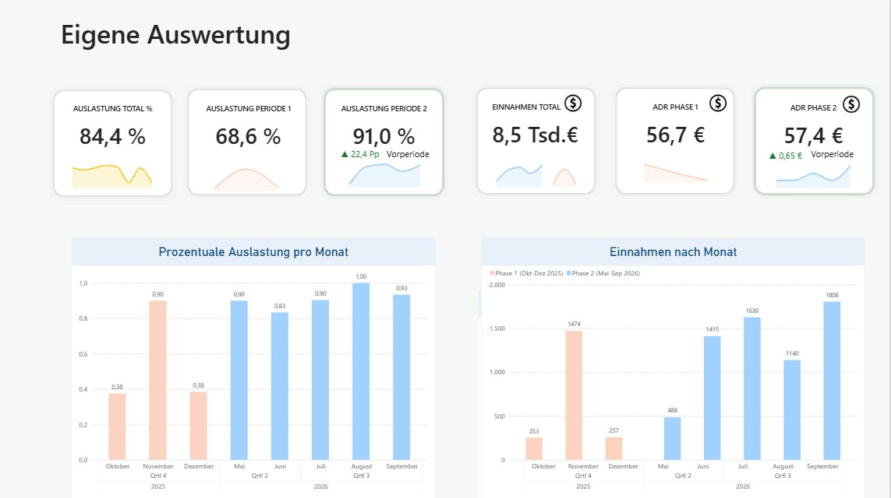

# Ferienwohnung – Revenue- & Auslastungsanalyse (Power BI)

> Portfolio-Projekt: Auswertung des eigenen Ferienwohnungs-Betriebs.
> Auslastung, Preisstrategie und Buchungsverhalten über zwei Vermietungsphasen.

**In short (EN):** End-to-end analysis of my own short-term rental business –
Airbnb revenue export → Python preparation → Power BI star schema. 44 bookings,
148 nights, €8,466 net revenue across two operating phases. Occupancy rose from
**68.6 % to 91.0 %**, while the net price per night stayed flat (€56.71 → €57.36)
– the revenue came from occupancy, not price (RevPAR +37 %). The data work is
the interesting part: mixed decimal separators in one export, payout rows that
mirror bookings, a double-counted occupancy bug, a cancellation that produced
revenue without nights, and Airbnb's fee-model switch that changed what
"price" means. All measures documented in [`dax/measures.md`](dax/measures.md).

<!-- Screenshot der Startseite -->


## Worum es geht

Ich betreibe eine Ferienwohnung mit Kurzzeitvermietung – in zwei Betriebsphasen
(**Okt–Dez 2025** und **Mai–Sep 2026**), davor und dazwischen Renovierung.
Für dieses Projekt habe ich die Buchungsdaten aus dem Airbnb-Einnahmen-Export
aufbereitet und in Power BI ausgewertet, mit dem Ziel, die Preisstrategie
datenbasiert zu steuern.

**Rolle:** Datenaufbereitung, Modellierung, DAX, Report-Design (allein)
**Werkzeuge:** Power BI Desktop, Power Query, DAX, Python (Datenaufbereitung)
**Datenbasis:** 44 Buchungen · 148 belegte Nächte · 8.465,94 € Netto-Umsatz

## Fragestellungen

1. Wie unterscheiden sich Auslastung und ADR zwischen Phase 1 und Phase 2?
2. Wie entwickelt sich der Umsatz je **verfügbarer** Nacht (RevPAR)?
3. Wie hat sich die Airbnb-Gebührenumstellung auf den Netto-Erlös ausgewirkt?
4. Welche Datenqualitätsprobleme stecken in einem Airbnb-Export – und wie
   wirken sie sich auf die Kennzahlen aus?

## Daten & Modell

**Datenquelle:** Airbnb-Einnahmen-Export (CSV). Aufbereitung mit Python,
Analyse in Power BI. Der Export mischt Buchungen, Auszahlungen und
Korrekturzeilen in einer Tabelle – die Aufbereitung trennt sie.

Star Schema:

| Tabelle | Typ | Inhalt |
| --- | --- | --- |
| `buchungen` | Fakt | 44 Zeilen: Anreise, Abreise, Nächte, Netto-Betrag, Gebühr, Vorlauf |
| `anpassungen` | Fakt | 1 Airbnb-Anpassung/Mediation |
| `kalender` | Dimension | Datumstabelle, als Datumstabelle markiert |
| `betriebsphasen` | Dimension | Buchbarkeitsfenster je Phase – steuert die Auslastung |

Die Screenshots der Modellansicht und der weiteren Report-Seiten liegen als
`pbix/eigene_Airbnb_Auswertung.pbix` bei (Power BI Desktop öffnen).

## Kennzahlen

| Kennzahl | Phase 1 (Okt–Dez 2025) | Phase 2 (Mai–Sep 2026) |
| --- | --- | --- |
| Buchungen | 7 | 37 |
| Belegte Nächte | 35 | 113 |
| Umsatz netto | 1.984,81 € | 6.481,13 € |
| **ADR netto** (Ø €/belegte Nacht) | 56,71 € | 57,36 € |
| **Brutto-Preis** (Ø € vor Gebühr) | 58,81 € | 70,33 € |
| **RevPAR netto** (Ø €/verfügbare Nacht) | 38,92 € | 53,12 € |
| Auslastung | 68,6 % | 91,0 % |
| Ø Aufenthalt | 5,0 Nächte | 3,1 Nächte |
| Servicegebühr-Quote | 3,6 % | 18,4 % |

> Auslastung = belegte Nächte im Buchbarkeitsfenster. Phase 1 war **24.10.–13.12.2025** buchbar (51 Tage; letzte Nacht 13.12., Abreise des letzten Gastes 14.12.2025), Phase 2 **22.05.–30.09.2026** (132 Tage − 10 gesperrte = 122 verfügbare Nächte).

Ausführliche Measure-Definitionen: [`dax/measures.md`](dax/measures.md)

## Report-Seiten

1. **Übersicht** – Umsatz, Auslastung, ADR und RevPAR als KPI-Karten + Verlauf je Phase
2. **Preis & Nachfrage** – ADR netto vs. Brutto-Preis, Wochentage, Buchungsvorlauf, Aufenthaltsdauer
3. **Datenqualität** – Umsatz vs. Belegung, Storno-Fall, Gebührenmodell-Sprung, offene Annahmen

Die Screenshots der Modellansicht und der weiteren Report-Seiten liegen als
`pbix/eigene_Airbnb_Auswertung.pbix` bei (Power BI Desktop öffnen).

## Erkenntnisse

- **Der Umsatz kam über die Auslastung, nicht über den Preis.**
  Der Netto-Preis je belegter Nacht blieb praktisch unverändert
  (56,71 € → 57,36 €, +1 %), während die Auslastung von **69 % auf 91 %** stieg.
  Der Umsatz je *verfügbarer* Nacht (RevPAR) stieg dadurch um **+37 %**
  (38,92 € → 53,12 €). ADR allein hätte das nicht gezeigt.

- **Airbnb hat das Gebührenmodell umgestellt – und damit die Preislogik.**
  Phase 1 (Split Fee): du zahlst **3,57 %**, der Gast zahlt ~14 % obendrauf und
  sieht die Gebühr im Checkout. Phase 2 (Host-Only Fee): du zahlst
  **15,5 % + MwSt. = 18,45 %**, der Gast sieht nur noch eine Zahl ohne Aufschlag.
  Folge: Um dieselbe Auszahlung zu halten, musste der Listenpreis um
  **18,3 %** steigen – er stieg um **19,6 %**. Die Erhöhung war also **genau
  richtig bemessen**: sie kompensiert exakt die Gebühr. Die Auszahlung je Nacht
  blieb praktisch konstant (56,71 € → 57,36 €).
  **Handlungsableitung:** Der Preisspielraum ist strukturell enger geworden –
  jede künftige Netto-Erhöhung um 1 € verlangt 1,23 € mehr Listenpreis
  (vorher 1,04 €). Bei 91 % Auslastung ist der Nachfrage-Raum da, um den
  *Netto*-Preis jetzt aktiv zu erhöhen statt nur die Gebühr zu kompensieren.
  **Wichtig für die Interpretation:** Der Gast sah in Phase 1 mehr als den
  Listenpreis (nämlich + seine Gebühr). Ein reiner Brutto-Vergleich über die
  Phasen vergleicht deshalb zwei verschiedene Dinge.

- **Eine doppelt gezählte Belegung kippt die Schlussfolgerung.**
  In einer ersten Version summierte ich die Nächte überlappender Aufenthalte
  doppelt. Dadurch sank der ADR scheinbar um 6 %, und die Story lautete
  „mehr Menge, weniger Preis". Nach der Korrektur – Nächte werden als
  **Vereinigung der Aufenthaltszeiträume** gezählt – dreht sich das Ergebnis:
  der Preis ist stabil. Genau deshalb trennt das Modell **Umsatz und Belegung
  in zwei Spalten** statt nur eine Betragssumme zu bilden.

- **Ein Storno kann Umsatz ohne Belegung sein.** Eine Buchung wurde storniert,
  aber trotzdem ausgezahlt (Same-Day-Storno): **127,43 €**, knapp 2 % des Umsatzes
  in Phase 2 – bei **null belegten Nächten**. Wer so etwas ungeprüft als Belegung
  zählt, verschlechtert Auslastung und ADR gleichermaßen.

- **Brutto-Beträge nicht naiv über die Phasen vergleichen.** Die Spalte
  `Bruttoeinkünfte` ist in Phase 1 der Listenpreis (ohne Gästegebühr), in Phase 2
  der Endpreis des Gastes. Verglichen wird deshalb auf der **Auszahlung (netto)**
  für die eigene Wirtschaftlichkeit und auf dem **Endpreis** für die Gästesicht.

- **Anreisen konzentrieren sich auf Donnerstag bis Sonntag** (68 % aller
  Check-ins; Freitag mit 14 Buchungen am stärksten) – das bestätigt die
  Wochenend-Nachfrage und erklärt die Preissetzung.

- **Der Buchungsvorlauf liegt im Schnitt bei 18,9 Tagen** (Median 14,
  Spanne 1–64 Tage) – ein Fenster, in dem dynamische Preise wirken können.

## Offengelegte Einschränkungen

- **Keine saisonale Aussage.** Zwei Phasen ergeben kein Jahr; Phase 1
  (Herbst/Winter) und Phase 2 (Sommer) unterscheiden sich **saisonal**.
  Der Phasenvergleich ist damit **nicht kausal**: Renovierung und Jahreszeit
  wirken gleichzeitig. Diese Verwechslungsgefahr wird bewusst benannt und im
  Report gezeigt, statt sie zu verschweigen.
- **Die Buchbarkeitsfenster sind bestätigt:** Phase 1 ab **24.10.2025**
  (Vermietungsstart), Phase 2 ab **22.05.2026**. Sie steuern die Auslastung
  direkt und stehen transparent in der Tabelle `betriebsphasen`.
- **Nebenkosten und Instandhaltung liegen noch nicht vor** → ein
  Deckungsbeitrag ist derzeit nicht berechenbar. Die Kostenseite ist der
  nächste Schritt.
- **Gesperrte Nächte sind nur teilweise bekannt.** Für Phase 2 ist ein Block
  dokumentiert – **07.–16.08.2026, 10 Nächte** (Eigennutzung/Instandhaltung) –
  und aus dem Nenner der Auslastung entfernt. Ohne ihn läge die Auslastung
  fälschlich bei 84,1 % statt 91,0 %. Weitere Sperren (z. B. in Phase 1) sind
  nicht erfasst; dort ist die Auslastung eine **Obergrenze**.
- Der Datensatz enthält **keine personenbezogenen Gästedaten**. Die
  Details-Spalte des Exports (Zahlungsadresse) wurde beim Aufbereiten verworfen.

## Was ich daraus mitgenommen habe

- Aufbereitung eines echten, unaufgeräumten Datenexports: gemischte
  Dezimaltrenner in einer Datei, Auszahlungszeilen, die Buchungen spiegeln,
  uneinheitliche Spalten über Monatsdateien
- Modellierung eines Geschäftsprozesses als Star Schema inkl. Datumstabelle
- Kennzahlen-Denken: von der Frage zur Measure-Definition (ADR, RevPAR, Auslastung)
- **Umgang mit Unsicherheit**: Annahmen dokumentieren, Sonderfälle sichtbar
  machen und eine gut klingende Schlussfolgerung verwerfen, wenn die Daten sie
  nach der Bereinigung nicht mehr tragen
- Storytelling im Report: Kennzahl → Ursache → Handlung

## Dateien

- `daten/buchungen.csv` – aufbereitete Buchungen (import-fertig)
- `daten/anpassungen.csv` – Airbnb-Anpassungen
- `daten/kalender.csv` – Datumstabelle (345 Tage, 10 Spalten)
- `daten/kalender_tagesbasis.csv` – Zwischenstand der Tages-Tabelle
- `daten/Airbnb_Datensatz_PowerBI.xlsx` – alle vier Tabellen als Excel-Datei
- `daten/datadictionary.md` – Spalten, Typen, bekannte Fallen
- `daten/build_datasets.py` – Roh-Export → `buchungen.csv`, `anpassungen.csv`, `kalender.csv`
- `daten/build_kalender_tagesbasis.py` – Tages-Tabelle mit Buchbarkeitsfenstern
- `daten/add_flags_to_kalender.py` – ergänzt `kalender.csv` um Betriebsphase/Verfügbar/Belegt
- `dax/measures.md` – alle Measures mit Erklärung
- `reports/Phasenvergleich_Ferienwohnung.tex` – Report-Quelle (LaTeX)
- `reports/Phasenvergleich_Ferienwohnung.pdf` – daraus gebautes PDF (3 Seiten)
- `screenshots/01_overview.png` – Startseite des Reports
- `pbix/eigene_Airbnb_Auswertung.pbix` – Power BI Datei

## Reproduktion

Der **Roh-Export ist nicht im Repo** – er enthält personenbezogene Zahlungsdaten
(Zahlungsadresse). Er ist im Airbnb-Konto unter *Einnahmen → Export* erhältlich.

```bash
export AIRBNB_RAW_CSV=/pfad/zu/airbnb_.csv
python3 daten/build_datasets.py             # Roh-Export → buchungen/anpassungen/kalender
python3 daten/build_kalender_tagesbasis.py  # Tages-Tabelle mit Buchbarkeitsfenstern
python3 daten/add_flags_to_kalender.py      # Flags in kalender.csv zurückschreiben
python3 reports/build_xlsx.py               # Excel-Datei für Power BI
tectonic reports/Phasenvergleich_Ferienwohnung.tex --outdir reports  # LaTeX-Report → PDF
```

Die Skripte sind idempotent: sie lesen die CSVs aus `daten/` und schreiben sie
zurück. Die Aufbereitung braucht nur die Python-Standardbibliothek; der Report ist
ein LaTeX-Dokument und wird mit [Tectonic](https://tectonic-typesetting.github.io)
gebaut (Tectonic zieht die Pakete selbst nach, kein TeX-Install nötig).

## Lizenz

MIT – siehe [`LICENSE`](LICENSE). Die Daten stammen aus meinem eigenen
Airbnb-Konto; der Roh-Export ist nicht Teil des Repos.
